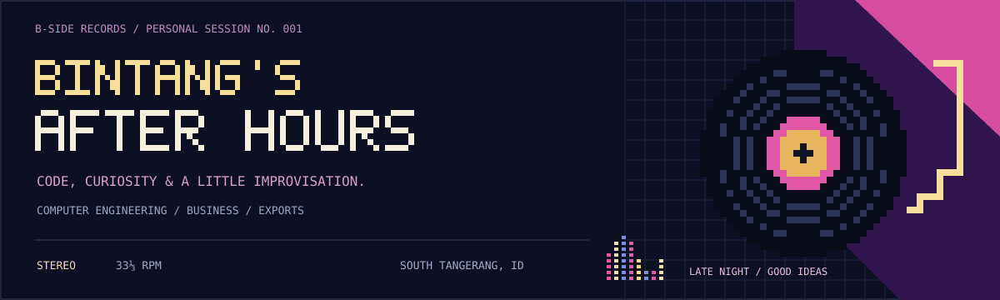
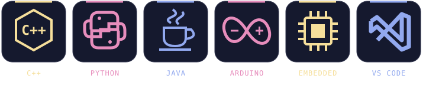

<p align="center">
  
</p>

<p align="center">
  <a href="#side-a--the-code"><strong>SIDE A · THE CODE</strong></a> &nbsp; / &nbsp;
  <a href="#side-b--beyond-the-code"><strong>SIDE B · THE BUSINESS</strong></a> &nbsp; / &nbsp;
  <a href="https://www.linkedin.com/in/bintang-arya-pradipta-36048b2a3/"><strong>SAY HELLO ↗</strong></a>
</p>

<br />

<table>
<tr>
<td width="33%" align="center" valign="middle">
  
  <br /><sub>THE AFTER HOURS COLLECTION · VOL. 01</sub>
</td>
<td width="67%" valign="top">

### Hey, I'm Bintang.

Computer Engineering student based in South Tangerang, Indonesia. I'm working toward becoming an **IoT & Embedded Systems Engineer**, learning to connect software, electronics, and real-world devices.

```text
bintang@after-hours:~$ whoami

  learning   C++ / Python / Java
  career     IoT & Embedded Systems Engineer
  stage      aspiring / building the foundations
  business   Vlora Nusantara
  exploring  exports & entrepreneurship
  location   Indonesia · UTC+7
  status     learning, one project at a time
```

<sub>A curious mind. A work in progress. Always room for another take.</sub>

</td>
</tr>
</table>

<br />

## Side A · The code



**Learning:** C++, Python, and Java. **Exploring:** Arduino and embedded systems. **Editor:** VS Code.

My career goal is to become an **IoT & Embedded Systems Engineer**. I'm building my foundations in programming, microcontrollers, and hardware–software integration.

| Track | What I'm working on |
| :--- | :--- |
| **01 / C++** | Strengthening the fundamentals, object-oriented programming, and data structures. |
| **02 / Python** | Practicing problem solving and building small, useful programs. |
| **03 / Java** | Learning object-oriented programming, one class at a time. |
| **04 / Embedded & IoT** | Exploring microcontrollers, electronics, and how code interacts with hardware. |

<details>
<summary><strong>Open the practice room ↗</strong></summary>

<br />

- [Python fundamentals](https://github.com/bintangry/python-basic-fundamentals)
- [Learning Python](https://github.com/bintangry/belajar-python)
- [Learning OOP with Java](https://github.com/bintangry/belajar-oop-java)

Small steps, experiments, and lessons along the way.

</details>

<br />

## Side B · Beyond the code

I'm also interested in **business, international trade, and exports** through **Vlora Nusantara**. I'm learning how products, suppliers, and buyers connect across borders—and where technology can make that process better.

- **Exports:** understanding products, buyer needs, and supplier relationships.
- **Business:** turning ideas into clear offers and useful solutions.
- **Technology × trade:** exploring tools that help organize data and simplify repetitive work.

<br />

## Let's trade notes

Happy to connect over **embedded systems, learning to code, business, or export ideas**.

[LinkedIn ↗](https://www.linkedin.com/in/bintang-arya-pradipta-36048b2a3/) &nbsp; · &nbsp; [Instagram ↗](https://www.instagram.com/bintangryaa/) &nbsp; · &nbsp; [GitHub ↗](https://github.com/bintangry)

<br />

<p align="center">
  
</p>

<br />

## The midnight arcade

My contribution history, with a little jazz-club energy.

<p align="center">
  
</p>

<p align="center"><sub>Refreshed daily with GitHub Actions · Built with <a href="https://github.com/abozanona/pacman-contribution-graph">pacman-contribution-graph</a></sub></p>
